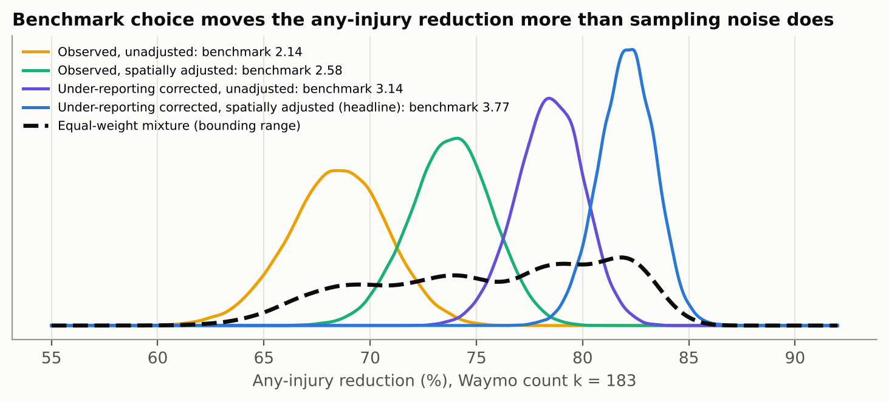

# How much evidence is enough? A Bayesian rare-event analysis of robotaxi crash data

An independent reconstruction of Waymo's rider-only crash record from NHTSA's public Standing General Order (SGO 2021-01) crash reports. It analyses that record with the rare-event Bayesian methods of nuclear probabilistic risk assessment (PRA) and compares the approach with the methodology Waymo publishes on its Safety Impact hub.

**Reports:** [full technical report (PDF, 31 pages)](reports/AV_Safety_Bayesian_Analysis_Albati_full_report.pdf) · [two-page summary (PDF)](reports/AV_Safety_Bayesian_Analysis_Albati_summary.pdf)



*Same 183 crashes, four human benchmarks: the choice of benchmark correction moves the any-injury reduction from 68.5% to 82.1%, more than twice the width of the headline 95% interval.*

## Key results

Waymo rider-only operations, 271.3 million miles, through June 2026.

| Outcome | This analysis: median reduction (95% CrI) | Same Bayesian model with Waymo's counts | Waymo published (95% CI) |
|---|---|---|---|
| Serious injury or worse | 89.3% (78.6–95.7%) | 94.5% (86.1–98.5%) | 94.8% (83.2–99.2%) |
| Airbag deployment, any vehicle | 83.5% (79.4–87.0%) | 81.7% (77.4–85.4%) | 81.7% (76.6–86.0%) |
| Any injury reported | 83.8% (81.2–86.1%) | 82.1% (79.4–84.6%) | 82.1% (78.9–85.0%) |

- **Reconstruction.** An automated pipeline using only public SGO fields finds 1,934 Waymo rider-only crashed vehicles; 1,925 of them (99.5%) are in Waymo's published crash list.
- **Agreement.** With the same counts, the Bayesian and frequentist methods give the same central estimates (within 0.3 points). The differences come from data curation and benchmark choice.
- **Benchmark uncertainty.** Waymo's under-reporting and spatial corrections are applied as fixed values. Across Waymo's own four benchmark versions, the any-injury reduction spans 68.5–82.1%.
- **Miles to demonstrate.** A new operator needs about 9.1 million miles with zero serious crashes to claim, at 95% confidence, that it beats humans on serious injuries. A fleet that is truly 80% safer reaches 80% power at about 18.5 million miles.
- **Crash mechanisms.** 62% of crashes occur while the Waymo vehicle is stationary. Crashes with cyclists or pedestrians injure someone 48% of the time, against 10% for light vehicles.

## Repository contents

| Path | Contents |
|---|---|
| `sgo_analysis.py` | Merges and de-duplicates the NHTSA files, isolates Waymo rider-only crashes, fits the Gamma–Poisson and Beta–binomial models, computes miles-to-demonstrate, and draws Figures 3, 5, 12, 13, 16 |
| `prepare_waymo_data.py` | Converts Waymo's downloaded crash list (CSV2) and comparison table (CSV3) into compact inputs |
| `compare_waymo.py` | Matches this analysis' crash set to Waymo's list by SGO Report ID and compares outcome flags |
| `comparison_figs.py` | Method comparison and uncertainty figures: posterior percentiles, exceedance curves, benchmark overlap, benchmark-version mixture, frequentist vs Bayesian intervals, power curves, event tree |
| `results/` | All output tables (CSV) and figures (PNG) produced by the scripts |
| `reports/` | Full technical report and two-page summary |
| `data/` | Download instructions; the raw data files are not redistributed |

## Reproduce

Requires Python 3.10+.

```bash
pip install -r requirements.txt
```

**1. Download the data** into `data/` (see [`data/README.md`](data/README.md)):

- NHTSA SGO ADS incident reports, from the [NHTSA crash-reporting page](https://www.nhtsa.gov/laws-regulations/standing-general-order-crash-reporting#data). Save the current file as `data/SGO-2021-01_Incident_Reports_ADS.csv`, and the Archive 2021–2025 file of the same name as `data/ADS_archive.csv`.
- Waymo Safety Impact hub files, from the download section of the [Waymo Safety Impact page](https://waymo.com/safety/impact/): CSV2 (crashes with SGO ID and group membership) and CSV3 (collision counts and comparison to benchmarks). Create a `data/waymo/` folder and save them there as `CSV2.csv` and `CSV3.csv`.

**2. Run the pipeline:**

```bash
python sgo_analysis.py data results
python prepare_waymo_data.py data/waymo/CSV2.csv data/waymo/CSV3.csv data
python compare_waymo.py data/waymo_crash_list_compact.txt results/sgo_ads_clean.csv results
python comparison_figs.py results data/waymo_csv3_key.csv
```

All random draws use fixed seeds, so the outputs in `results/` are reproduced exactly. Exposure and human benchmarks are taken from Waymo's hub release for data through June 2026. A later hub release will change the counts, the benchmarks and the miles in `sgo_analysis.py` and `comparison_figs.py`.

## Method in brief

- **Rates.** Crashed vehicles per million miles follow a Poisson process, with a Jeffreys prior giving the posterior Gamma(*k* + ½, *M*).
- **Reductions.** The reduction 1 − λ/λ_H is summarized by percentiles, exceedance probabilities and P(better than human).
- **Benchmark uncertainty.** Propagated as parametric (lognormal) uncertainty, plus a bounding mixture across Waymo's benchmark versions.
- **Miles to demonstrate.** M\* = Q_Gamma(k+½,1)(0.95) / (f·λ_H).
- **Crash mechanisms.** Event-tree branches by vehicle state and crash partner, with Jeffreys Beta posteriors.
- **Comparison.** Waymo's Clopper–Pearson rate-ratio intervals (Nelson, 1970) are reproduced side by side.

## Limitations

- SGO reports are self-reported and partly redacted, and the reporting rules changed in 2025. This analysis cannot reproduce Waymo's manual verification against police reports, video and narratives.
- The human benchmarks are Waymo's. This analysis quantifies their uncertainty but does not construct independent benchmarks.
- Results for zero or one event depend on the prior.
- Narrative classification uses keywords and is approximate. Eight early-2021 crashes were likely misclassified as rider-only.

See Section 8 of the full report.

## Citation

> Albati, M. (2026). *How Much Evidence Is Enough? A Bayesian Rare-Event Analysis of Driverless-Vehicle Crash Data.* Technical report and code. https://github.com/&lt;username&gt;/av-safety-bayesian-analysis

## License

Code is released under the MIT License (see `LICENSE`). The NHTSA data are U.S. government works. Waymo's hub files are Waymo's and are not redistributed here; download them from the source.

## Author

Mohammad Albati, Ph.D. candidate in Nuclear, Plasma & Radiological Engineering, University of Illinois Urbana-Champaign · malbati2@illinois.edu
